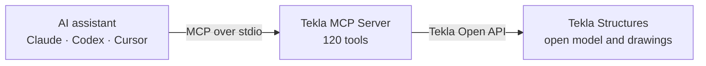

<div align="center">


# Tekla MCP Server

**Talk to your Tekla Structures model.**<br>
An [MCP](https://modelcontextprotocol.io/) server that lets Claude, Codex, Cursor and other AI
assistants read, analyze and — after a preview — edit the open model and its drawings.

[](https://github.com/tempalg1n/tekla-mcp-server/releases)
[](https://github.com/tempalg1n/tekla-mcp-server/actions/workflows/ci.yml)
[](#supported-tekla-versions)
[](docs/tools.md)
[](LICENSE)

[Quick start](#quick-start-windows) · [What it can do](#what-it-can-do) · [Safety](#safety) ·
[Tools](#tools) · [Docs](#documentation)

English · [Русский](README.ru.md)

</div>

> [!NOTE]
> **v0.9.0 — early development.** Run on live Tekla 2021 and 2023 models; tools and behavior may
> still change between releases. Using Tekla 2024–2026? [Tell us how it goes](#supported-tekla-versions).

## How it works



The server runs on your computer next to Tekla: the assistant calls its tools, and the server
answers from the open model. It makes no network calls of its own — model data leaves the machine
only in what the assistant sends to its provider.

## What it can do

- 🔎 **Ask and analyze** — find and count objects, sum and group weights by profile, material,
  assembly or any UDA, discover attributes, check numbering, run QA checks. Streamed and paged for
  models with 400k+ objects.
- 📐 **Read geometry** — part solids with cuts, exact arcs of curved members, grids, IFC reference
  objects.
- 👁️ **See the model** — pictures of a live Tekla view or the open drawing, and server-drawn
  numbered schematics (beta), returned to the assistant as images.
- 📦 **Move bulk data through files** — export parts or IFC objects with geometry; write UDAs from
  a GUID-keyed file.
- 🏗️ **Edit the model** — create, modify and delete parts, connections and components; set UDAs;
  save or switch models.
- 📄 **Work on drawings** *(experimental)* — list and check drawings; create, update, issue and
  print them; edit views, dimensions, marks and annotations.
- 🧩 **Script the rest** — policy-checked C# against the Open API, with signatures looked up in a
  reference generated from your own Tekla.

**Things to ask:**

> “Group all parts by `USER_FIELD_1` and show the weight per group.”<br>
> “I’ve selected some parts — sum their weight by profile.”<br>
> “Give me the radius, chord and arc length of this curved tube.”<br>
> “Which assembly drawings are issued but modified? Don’t open them.”

## Quick start (Windows)

1. Download the zip for **your** Tekla version from
   [Releases](https://github.com/tempalg1n/tekla-mcp-server/releases):
   `TeklaMcp.Server-v0.9.0-tekla2021.zip` … `-tekla2026.zip`. Each zip is built for one Tekla
   version and loads the Tekla DLLs from your installation.
2. Extract it to a folder, keeping all files together.
3. Open a model in Tekla Structures and add the server to your MCP client:

   ```json
   {
     "mcpServers": {
       "tekla": { "command": "C:\\Tools\\TeklaMcp-tekla2023\\TeklaMcp.Server.exe" }
     }
   }
   ```

4. Ask the assistant to call `tekla_get_connection_info`: it shows the open model and which Tekla
   the server talks to.

> [!TIP]
> **Codex:** run `codex\Install-CodexPlugin.ps1` from the zip instead of step 3 — it builds a
> Tekla MCP plugin card ([details](docs/setup.md#codex-plugin-card)).<br>
> **No Tekla at hand?** The `…-net8.0-mock.zip` (or `dotnet run --project src/TeklaMcp.Server` in
> a source checkout) serves a small synthetic model on any OS.

Requirements, troubleshooting and building from source: [docs/setup.md](docs/setup.md).

## Safety

| Guard | How it works |
|---|---|
| **Preview first** | Model and drawing writes take `apply=false` by default: they return a plan and change nothing, and the assistant is told to show it and ask before `apply=true`. Only UI actions (selection, view capture) happen at once. |
| **Honest results** | Every write says what happened — `outcome` (`planned`, `committed`, `partial`, `unknown`, …) — and where — `target` (model path, Tekla process). With `expectedModelPath`, a write aimed at another open model is refused before anything is written. |
| **Traceable** | Created and changed objects carry the `MCP_ORIGIN` UDA; Tekla's Ctrl+Z undoes committed changes. |
| **Approved scripts only** | Scripts are read-only by default; a mutating one runs only with the SHA-256 of the exact source the user approved. Scripts get no file, network or process access. |
| **Read-only mode** | `TEKLA_MCP_READ_ONLY=1` serves only the 50 read tools and blocks writes at runtime too. Every tool carries MCP annotations, so clients can approve reads and ask before writes. |
| **Your folders** | The file-exchange tools use only folders under `TEKLA_MCP_FILE_ROOT` (default: `%LOCALAPPDATA%\TeklaMcp\exchange` and the model folder). PDF export prints to the path shown in its preview. |

## Tools

120 tools in seven toolsets. `TEKLA_MCP_TOOLSETS` can serve fewer of them, for clients that load
every tool description into the context. Every tool, filter and convention:
**[docs/tools.md](docs/tools.md)**.

| Toolset | Tools | What |
|---|---:|---|
| `core` | 4 | connection info, model summary, numbering status, `tekla_report_gap` — always on |
| `model` | 42 | queries, properties, geometry, grids, IFC references, assemblies, catalogs, UDAs, part/connection/component writes, generators, save/open |
| `analytics` | 10 | count, sum and group weights, distinct values, attribute search, UDA discovery, QA checks, selection |
| `files` | 3 | bulk export of parts and IFC objects, UDA import from a file |
| `drawings` | 54 | drawing list and checks, a picture of the open drawing, lifecycle and PDF, views, dimensions, marks, annotations *(experimental)* |
| `scripting` | 5 | API reference search, check and run C# scripts |
| `visual` | 2 | `tekla_capture_view`, `tekla_render_schematic` *(beta)* |

When no tool fits, the assistant follows a ladder built into the server: a dedicated tool, then a
checked script, then `tekla_report_gap`, which drafts a ready-to-file issue.

## Configuration

All settings are optional environment variables, e.g. in the client's `env` block:

| Variable | Use it to |
|---|---|
| `TEKLA_BIN_DIR` | point at the Tekla Open API folder when auto-detection fails |
| `TEKLA_MCP_FILE_ROOT` | choose the folders the file tools may use (`;`-separated) |
| `TEKLA_MCP_READ_ONLY` | `1` = serve read tools only |
| `TEKLA_MCP_TOOLSETS` | serve only some toolsets, e.g. `model,analytics` |

All variables: [docs/setup.md](docs/setup.md#configuration).

## Supported Tekla versions

| Tekla Structures | Status |
|---|---|
| 2021, 2023 | ✅ run on live models by the maintainers |
| 2025, 2026 | 🟡 used in the field ([#15](https://github.com/tempalg1n/tekla-mcp-server/issues/15), [#17](https://github.com/tempalg1n/tekla-mcp-server/issues/17)); fixes await the reporters' confirmation |
| 2022, 2024 | ⚪ built and compiled, not run yet |

Tekla 2024 and later talk over another transport (Trimble.Remoting), so the reconnect after a
Tekla restart is not active there yet. If you run any version not marked ✅, please
[open an issue](https://github.com/tempalg1n/tekla-mcp-server/issues) with the
`tekla_get_connection_info` output — `tekla_report_gap` drafts one for you.

## New in 0.9.0

- **Field fixes** from Tekla 2021 work: numeric UDAs that read as blank, part edits Tekla accepted
  but did not store (every written part is now read back and compared), dimension units and arcs,
  section views without their attribute file, a closed model that looked empty.
- **New reads:** `tekla_get_numbering_status`; curved Beams in `tekla_get_part_curve_geometry`.
- **Drawings:** a picture of the open drawing (`tekla_capture_drawing`), so the assistant can check
  its own edits; mark contents and custom marks, view labels, standalone detail and section marks,
  part and bolt geometry in view coordinates, GA views placed by their frame.
- **Tool annotations, read-only mode and toolsets.**

> [!IMPORTANT]
> A drawing write that says `committed` is **not saved** yet — results show `drawingSaved`. Call
> `tekla_save_drawing` after each milestone: Tekla drops unsaved drawing edits when the model is
> reopened.

Release notes: [docs/releases/v0.9.0.md](docs/releases/v0.9.0.md) · history:
[CHANGELOG.md](CHANGELOG.md).

## Known limitations

- The drawing layer is **experimental**, and `tekla_render_schematic` is **beta**.
  `tekla_capture_drawing` is live-verified on Tekla 2021 only.
- **Not yet run on live Tekla:** the drawing writes of 0.9.0, the `unknown` write outcome,
  `tekla_get_part_solid`, `tekla_save_model` / `tekla_open_model`, `tekla_create_component` with a
  real plugin. Details per entry in [CHANGELOG.md](CHANGELOG.md).
- **One Tekla instance per version:** the server cannot choose between several running Teklas of
  one version yet — pass `expectedModelPath` to writes.
- **Whole-model scans** are limited by the client's ~60 s request timeout — page them with
  `maxObjects` + `cursor`.

Next up: Tekla instance selection, reconnect for 2024+, scan speed on 400k+ models, bolt, weld and
rebar details — see [docs/backlog.md](docs/backlog.md).

## Documentation

| Document | What is inside |
|---|---|
| [Setup](docs/setup.md) | install, MCP clients, Codex card, configuration, build from source |
| [Tools](docs/tools.md) | every tool, shared filters, write and drawing conventions, example prompts |
| [Architecture](docs/architecture.md) | how the server is built, and why |
| [Tekla API notes](docs/tekla-api-notes.md) | Open API findings and version quirks |
| [Contributing](CONTRIBUTING.md) · [AGENTS.md](AGENTS.md) | development and conventions |

## Credits and license

Developed with the help of [Claude](https://www.anthropic.com/claude) (Anthropic).
Tekla Structures is a product of [Trimble](https://www.tekla.com/); this project is not affiliated
with or endorsed by Trimble. Licensed under [MIT](LICENSE).
