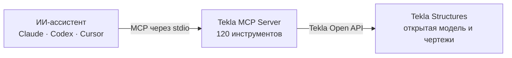

<div align="center">


# Tekla MCP Server

**Поговорите со своей моделью Tekla Structures.**<br>
[MCP](https://modelcontextprotocol.io/)-сервер, через который Claude, Codex, Cursor и другие
ИИ-ассистенты читают, анализируют и — после предпросмотра — правят открытую модель и её чертежи.

[](https://github.com/tempalg1n/tekla-mcp-server/releases)
[](https://github.com/tempalg1n/tekla-mcp-server/actions/workflows/ci.yml)
[](#поддерживаемые-версии-tekla)
[](docs/tools.md)
[](LICENSE)

[Быстрый старт](#быстрый-старт-windows) · [Что умеет](#что-умеет) · [Безопасность](#безопасность) ·
[Инструменты](#инструменты) · [Документация](#документация)

[English](README.md) · Русский

</div>

> [!NOTE]
> **v0.9.0 — ранняя стадия разработки.** Проверено на живых моделях Tekla 2021 и 2023; инструменты
> и поведение ещё могут меняться между релизами. Работаете в Tekla 2024–2026?
> [Расскажите, как прошло](#поддерживаемые-версии-tekla).

## Как это работает



Сервер работает на вашем компьютере рядом с Tekla: ассистент вызывает его инструменты, а сервер
отвечает данными из открытой модели. Сам сервер в сеть не ходит — данные модели покидают компьютер
только в том, что ассистент отправляет своему провайдеру.

## Что умеет

- 🔎 **Отвечать и анализировать** — искать и считать объекты, суммировать и группировать вес по
  профилю, материалу, сборке или любому UDA, искать атрибуты, проверять нумерацию, запускать
  QA-проверки. Потоково и постранично — для моделей от 400 тыс. объектов.
- 📐 **Читать геометрию** — тела деталей с вырезами, точные дуги гнутых элементов, оси, объекты
  опорных IFC-моделей.
- 👁️ **Видеть модель** — снимки живого вида Tekla и открытого чертежа, нумерованные схемы, которые
  рисует сам сервер (бета); ассистент получает их как изображения.
- 📦 **Гонять большие объёмы через файлы** — выгрузка деталей и IFC-объектов с геометрией, запись
  UDA из файла по GUID.
- 🏗️ **Править модель** — создавать, изменять и удалять детали, соединения и компоненты; задавать
  UDA; сохранять и переключать модели.
- 📄 **Работать с чертежами** *(экспериментально)* — список и проверки чертежей; создание,
  обновление, выпуск и печать; виды, размеры, марки и аннотации.
- 🧩 **Дописывать недостающее скриптом** — проверенный политикой C# к Open API; сигнатуры
  ассистент сверяет по справочнику, который сервер строит из вашей Tekla.

**Что можно спросить:**

> «Сгруппируй все детали по `USER_FIELD_1` и покажи вес каждой группы.»<br>
> «Я выделил детали — посчитай их вес по профилям.»<br>
> «Дай радиус, хорду и длину дуги этой гнутой трубы.»<br>
> «Какие сборочные чертежи выпущены, но изменены? Не открывай их.»

## Быстрый старт (Windows)

1. Скачайте zip для **своей** версии Tekla со страницы
   [Releases](https://github.com/tempalg1n/tekla-mcp-server/releases):
   `TeklaMcp.Server-v0.9.0-tekla2021.zip` … `-tekla2026.zip`. Каждый zip собран под одну версию
   Tekla и загружает DLL Tekla из вашей установки.
2. Распакуйте его в папку, не разделяя файлы.
3. Откройте модель в Tekla Structures и добавьте сервер в MCP-клиент:

   ```json
   {
     "mcpServers": {
       "tekla": { "command": "C:\\Tools\\TeklaMcp-tekla2023\\TeklaMcp.Server.exe" }
     }
   }
   ```

4. Попросите ассистента вызвать `tekla_get_connection_info`: он покажет открытую модель и с какой
   Tekla работает сервер.

> [!TIP]
> **Codex:** вместо шага 3 запустите `codex\Install-CodexPlugin.ps1` из zip — он соберёт карточку
> плагина Tekla MCP ([подробнее](docs/setup.md#codex-plugin-card), на английском).<br>
> **Нет Tekla под рукой?** `…-net8.0-mock.zip` (или `dotnet run --project src/TeklaMcp.Server` из
> исходников) отдаёт небольшую синтетическую модель на любой ОС.

Требования, решение проблем и сборка из исходников — [docs/setup.md](docs/setup.md) (на английском).

## Безопасность

| Защита | Как работает |
|---|---|
| **Сначала предпросмотр** | Запись в модель и чертежи по умолчанию идёт с `apply=false`: инструмент возвращает план и ничего не меняет, а ассистент обязан показать план и спросить перед `apply=true`. Сразу выполняются только действия в интерфейсе (выделение, снимок вида). |
| **Честный результат** | Каждая запись сообщает, что произошло, — `outcome` (`planned`, `committed`, `partial`, `unknown`, …) — и куда — `target` (путь модели, процесс Tekla). С `expectedModelPath` запись в другую открытую модель отклоняется до того, как что-либо записано. |
| **Следы и откат** | Созданные и изменённые объекты помечаются UDA `MCP_ORIGIN`; закоммиченные изменения откатываются Ctrl+Z в Tekla. |
| **Только одобренные скрипты** | По умолчанию скрипты только читают; изменяющий скрипт выполняется лишь с SHA-256 того самого текста, который одобрил пользователь. Доступа к файлам, сети и процессам у скриптов нет. |
| **Режим только для чтения** | `TEKLA_MCP_READ_ONLY=1` оставляет 50 читающих инструментов и дополнительно блокирует запись во время выполнения. У каждого инструмента есть MCP-аннотации: клиент может одобрять чтение без вопросов и спрашивать перед записью. |
| **Ваши папки** | Файловый обмен работает лишь в папках из `TEKLA_MCP_FILE_ROOT` (по умолчанию `%LOCALAPPDATA%\TeklaMcp\exchange` и папка модели). Экспорт в PDF печатает по пути, показанному в предпросмотре. |

## Инструменты

120 инструментов в семи наборах. `TEKLA_MCP_TOOLSETS` позволяет отдавать только часть наборов —
для клиентов, которые загружают описания всех инструментов в контекст. Каждый инструмент, фильтры
и соглашения — **[docs/tools.md](docs/tools.md)** (на английском).

| Набор | Инструментов | Что входит |
|---|---:|---|
| `core` | 4 | подключение, сводка по модели, статус нумерации, `tekla_report_gap` — всегда включён |
| `model` | 42 | запросы, свойства, геометрия, оси, опорные IFC-модели, сборки, каталоги, UDA, запись деталей/соединений/компонентов, генераторы, сохранение и открытие модели |
| `analytics` | 10 | подсчёт, сумма и группировка веса, уникальные значения, поиск атрибутов, обзор UDA, QA-проверки, выделение |
| `files` | 3 | массовая выгрузка деталей и IFC-объектов, запись UDA из файла |
| `drawings` | 54 | список и проверки чертежей, снимок открытого чертежа, жизненный цикл и PDF, виды, размеры, марки, аннотации *(экспериментально)* |
| `scripting` | 5 | поиск по справочнику API, проверка и запуск C#-скриптов |
| `visual` | 2 | `tekla_capture_view`, `tekla_render_schematic` *(бета)* |

Если подходящего инструмента нет, ассистент идёт по лестнице, заложенной в сервер: сначала
специальный инструмент, затем проверенный скрипт, затем `tekla_report_gap` — он готовит черновик
issue.

## Настройка

Все настройки — необязательные переменные окружения, например в блоке `env` клиента:

| Переменная | Для чего |
|---|---|
| `TEKLA_BIN_DIR` | указать папку Tekla Open API, если она не нашлась автоматически |
| `TEKLA_MCP_FILE_ROOT` | задать папки для файловых инструментов (через `;`) |
| `TEKLA_MCP_READ_ONLY` | `1` — только читающие инструменты |
| `TEKLA_MCP_TOOLSETS` | отдавать только часть наборов, например `model,analytics` |

Все переменные — в [docs/setup.md](docs/setup.md#configuration).

## Поддерживаемые версии Tekla

| Tekla Structures | Статус |
|---|---|
| 2021, 2023 | ✅ проверено мейнтейнерами на живых моделях |
| 2025, 2026 | 🟡 используется в работе ([#15](https://github.com/tempalg1n/tekla-mcp-server/issues/15), [#17](https://github.com/tempalg1n/tekla-mcp-server/issues/17)); исправления ждут подтверждения от авторов issue |
| 2022, 2024 | ⚪ собрано и компилируется, ещё не запускалось |

Tekla 2024 и новее общаются через другой транспорт (Trimble.Remoting), поэтому переподключение
после перезапуска Tekla там пока не работает. Если у вас версия без ✅, пожалуйста,
[откройте issue](https://github.com/tempalg1n/tekla-mcp-server/issues) с выводом
`tekla_get_connection_info` — черновик подготовит `tekla_report_gap`.

## Что нового в 0.9.0

- **Исправления по полевым отчётам** с Tekla 2021: числовые UDA читались как пустые; правки
  деталей, которые Tekla приняла, но не сохранила (теперь каждая записанная деталь перечитывается и
  сверяется); единицы и дуги размеров; разрезы без своего файла атрибутов; закрытая модель
  выглядела пустой.
- **Новое чтение:** `tekla_get_numbering_status`; гнутые Beam в `tekla_get_part_curve_geometry`.
- **Чертежи:** снимок открытого чертежа (`tekla_capture_drawing`) — ассистент сам проверяет свои
  правки; содержимое марок и собственные марки, подписи видов, отдельные метки узлов и разрезов,
  геометрия деталей и болтов в координатах вида, GA-виды по рамке.
- **Аннотации инструментов, режим только для чтения и наборы инструментов.**

> [!IMPORTANT]
> Запись в чертёж с итогом `committed` **ещё не сохранена** — смотрите `drawingSaved`. Вызывайте
> `tekla_save_drawing` после каждого этапа: при повторном открытии модели Tekla теряет
> несохранённые правки чертежей.

Заметки к релизу — [docs/releases/v0.9.0.md](docs/releases/v0.9.0.md), история —
[CHANGELOG.md](CHANGELOG.md) (на английском).

## Известные ограничения

- Слой чертежей **экспериментальный**, `tekla_render_schematic` — **бета**.
  `tekla_capture_drawing` проверен вживую только на Tekla 2021.
- **Ещё не прогонялось на живой Tekla:** запись в чертежи из 0.9.0, итог записи `unknown`,
  `tekla_get_part_solid`, `tekla_save_model` / `tekla_open_model`, `tekla_create_component` с
  настоящим плагином. Подробности по пунктам — в [CHANGELOG.md](CHANGELOG.md).
- **Один экземпляр Tekla на версию:** выбирать между несколькими запущенными Tekla одной версии
  сервер пока не умеет — передавайте `expectedModelPath` при записи.
- **Сканы всей модели** ограничены таймаутом клиента (~60 с) — разбивайте их на страницы через
  `maxObjects` + `cursor`.

Дальше в планах: выбор экземпляра Tekla, переподключение для 2024+, скорость сканов на моделях от
400 тыс. объектов, подробности болтов, швов и арматуры — см. [docs/backlog.md](docs/backlog.md).

## Документация

Вся документация — на английском.

| Документ | Что внутри |
|---|---|
| [Setup](docs/setup.md) | установка, MCP-клиенты, карточка Codex, настройка, сборка из исходников |
| [Tools](docs/tools.md) | все инструменты, общие фильтры, правила записи и чертежей, примеры запросов |
| [Architecture](docs/architecture.md) | как устроен сервер и почему |
| [Tekla API notes](docs/tekla-api-notes.md) | находки по Tekla Open API и особенности версий |
| [Contributing](CONTRIBUTING.md) · [AGENTS.md](AGENTS.md) | разработка и соглашения |

## Авторство и лицензия

Разработано с помощью [Claude](https://www.anthropic.com/claude) (Anthropic).
Tekla Structures — продукт [Trimble](https://www.tekla.com/); проект не аффилирован с Trimble и не
одобрен ею. Лицензия [MIT](LICENSE).
